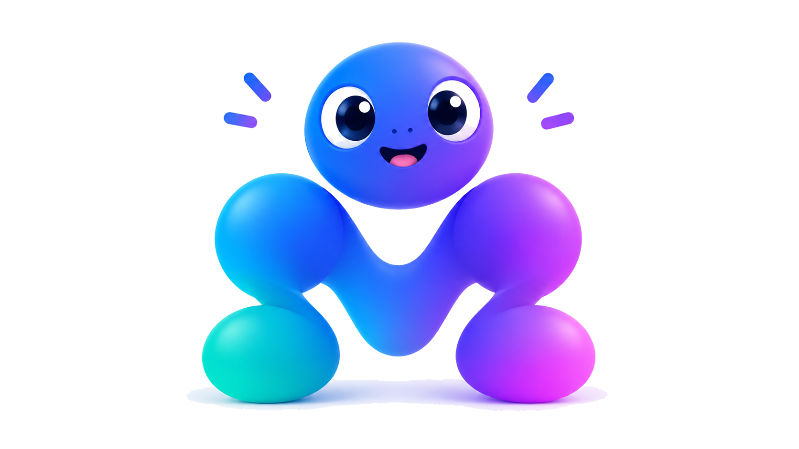
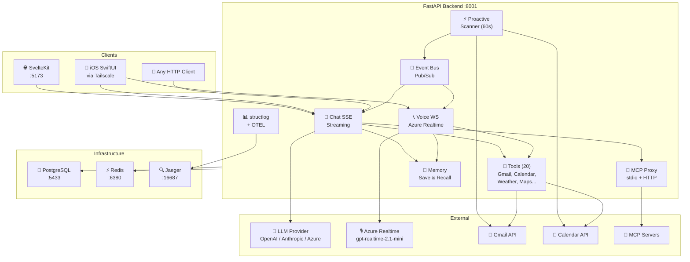
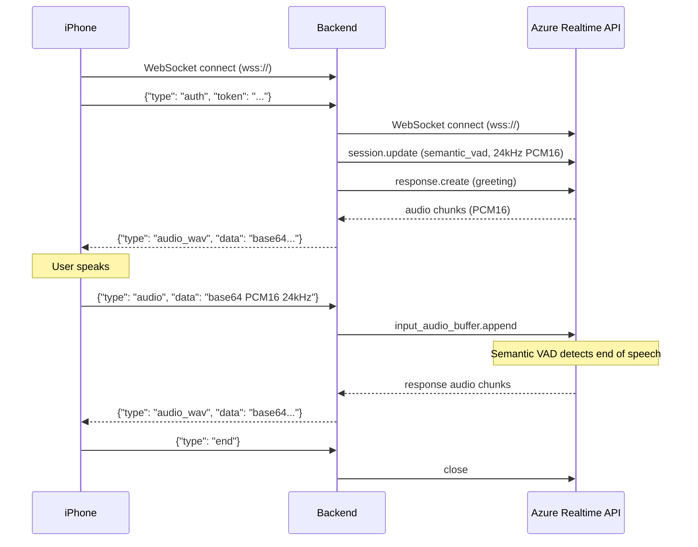
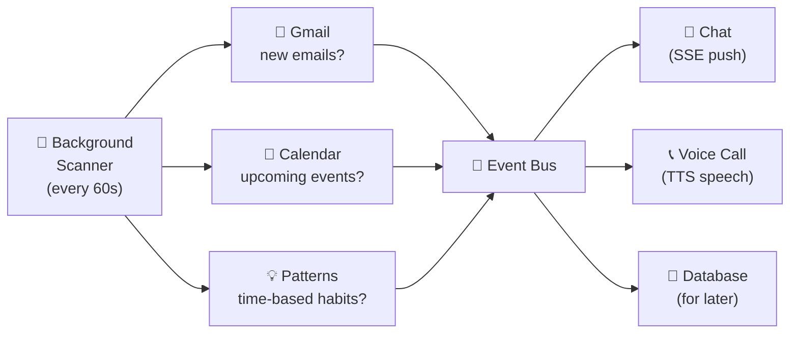

# Motes — Your agents, your models, your data

<p align="center">
  
</p>

<p align="center">
  <strong>Open-source, model-agnostic, self-hosted personal AI agents.</strong><br/>
  An alternative to OpenAI Dots that works with any LLM, runs on your infrastructure, and respects your privacy.
</p>

<p align="center">
  
  
  
  
  
  
</p>

---

## Screenshots & Demo

> 📸 **Screenshots coming soon** — web UI, iOS app, and voice call demos.

<!-- TODO: Replace these placeholders with actual screenshots

### Web UI
<p align="center">
  
</p>

### iOS App
<p align="center">
  
  
  
</p>

### Demo Video
[](https://youtube.com/watch?v=PLACEHOLDER)
▶️ Watch the 3-minute demo

-->

---

## Why I Built This

When OpenAI launched **Dots** in September 2026 — always-on AI agents that manage your email, calendar, and services — I wanted exactly that. But with my own model choice, on my own server, and available in the EU where I live.

As a software engineer with **20+ years in tech** and an **11x Microsoft MVP**, I had the architecture patterns ready from my earlier project **Cogentrex**, an AI agent governance framework I'd built for enterprise orchestration. The production patterns — structured logging, OpenTelemetry tracing, async SQLAlchemy, tool registry, approval system, and TDD discipline — carried forward directly into Motes.

Motes is the result: a **full-stack personal AI platform** I use every day. Backend in Python/FastAPI, frontend in SvelteKit, native iOS app in SwiftUI, with real-time voice calls, 20 service integrations, proactive intelligence, and persistent memory — all running on a single Mac Mini via Tailscale.

**This project demonstrates**: async Python at scale, real-time WebSocket audio pipelines, OAuth2 flows, MCP protocol integration, native iOS development, and infrastructure-as-code with Docker Compose.

---

## Motes vs OpenAI Dots

| Feature | OpenAI Dots | Motes |
|---|---|---|
| Model choice | GPT only | Any LLM (OpenAI, Anthropic, local) |
| Data location | OpenAI servers | Your server |
| EU/UK | Not available | Works everywhere |
| Integrations | Limited | 20 services, community-driven |
| Voice calls | Yes | Yes (Azure Realtime API) |
| iOS app | No | Native SwiftUI |
| Self-hosted | No | Docker Compose |
| Open source | No | MIT License |
| Price | $200/mo | Free (self-hosted) |

---

## Features

### 💬 Chat
- SSE streaming responses with tool calling
- Markdown rendering (tables, code blocks, lists)
- Conversation history (rename, delete, resume)
- Proactive notifications pushed directly into the conversation

### 📞 Voice Calls
- Real-time voice via Azure OpenAI Realtime API
- Semantic VAD (knows when you're done talking)
- Echo cancellation on iOS (AVAudioEngine)
- Configurable voice personality and accent
- Speaker/earpiece toggle, mute, live captions

### 🔧 20 Integrations

**Built-in (no API key needed):** Weather, Web Search, Apple Reminders, Apple Notes, Maps, News, Local Files

**OAuth (consent screen):** Gmail, Google Calendar

**API Key:** GitHub, Slack, Todoist, Notion, Spotify, Home Assistant, Outlook, Flights & Hotels, Telegram

**MCP Protocol:** Any stdio or HTTP MCP server — community-driven, composable

### ⚡ Proactive Intelligence
- Background scanner checks Gmail/Calendar every 60 seconds
- Notifications appear directly in your conversation (chat or voice)
- Pattern learning — after 3+ messages about "email" at the same hour, Motes proactively suggests checking your inbox

### 🧠 Persistent Memory
- Say "remember that I live in Brussels" — the agent saves it across sessions
- Memory works in both chat and voice calls
- Agent recalls facts when relevant to the conversation
- Categories: personal, work, preference, family, health

### 📱 Native iOS App
- Pure SwiftUI — no WebView
- Chat with SSE streaming + voice calls with AVAudioEngine
- Service management, personality presets, settings
- Connects securely via Tailscale HTTPS

### 📷 Vision
- Send images from camera or photo library
- Agent analyzes images and responds in context

---

## How It Works

### Proactive Intelligence Pipeline

```
Background Scanner (every 60s)
  ├─ scan_gmail() → new email? → notify in chat
  ├─ scan_calendar() → upcoming event? → notify in chat
  └─ check_patterns() → time-based suggestion? → notify in chat
                              │
               ┌──────────────┼──────────────┐
               │              │              │
          💬 Chat         📞 Voice Call    🔔 Stored
          (SSE push)      (TTS speech)    (for later)
```

### Memory System

The agent has `memory_save` and `memory_recall` tools. When you say *"recuerda que mi hija se llama Victoria"*, the agent calls `memory_save(fact="User's daughter is named Victoria", category="family")`. Next time you ask about family, it recalls this fact automatically.

---

## Architecture

### Heritage

Motes evolved from **Cogentrex**, my earlier AI agent governance framework designed for enterprise orchestration. The core patterns that carry forward:

| Cogentrex Pattern | Motes Implementation |
|---|---|
| Policy engine (deterministic action rules) | Simplified approval system (auto/manual/never per action) |
| Secure tool registry with schema + permissions | 20 built-in tools + MCP connector registry |
| Approval broker for human-in-the-loop | iOS approval UI with approve/deny per tool call |
| Run ledger (append-only audit trail) | PostgreSQL message + tool call history |
| Event sink for real-time activity streaming | SSE event bus for proactive notifications |
| Structured logging + OTEL tracing | structlog JSON + Jaeger traces on every LLM/tool call |
| TDD discipline (1200+ tests) | 229 tests (pytest + vitest + XCTest) |

### System Overview



### Voice Call Pipeline



### Proactive Intelligence Flow



---

## Project Stats

| Metric | Count |
|---|---|
| Backend Python files | 71 |
| Backend lines of code | 12,400+ |
| Frontend components (Svelte/TS) | 26 |
| iOS Swift files | 44 |
| iOS lines of code | 3,700+ |
| Test functions | 229 |
| Git commits | 192 |
| Service integrations | 20 |

---

## Tech Stack

| Layer | Technology |
|---|---|
| **Backend** | Python 3.12, FastAPI, SQLAlchemy (async), structlog, OpenTelemetry |
| **Frontend** | SvelteKit 5, Tailwind CSS v4, TypeScript |
| **iOS** | SwiftUI, AVAudioEngine, URLSession, MVVM |
| **Database** | PostgreSQL 16 with pgvector |
| **Cache** | Redis 7 |
| **Observability** | Jaeger (distributed traces), structlog (JSON structured logs) |
| **Voice** | Azure OpenAI Realtime API, Edge TTS, faster-whisper (local STT) |
| **Connectors** | MCP Protocol (stdio + HTTP transports) |
| **Infrastructure** | Docker Compose, Tailscale (zero-config HTTPS) |

---

## Quick Start

### Prerequisites
- Python 3.12+, [uv](https://docs.astral.sh/uv/)
- Node.js 20+, npm
- Docker & Docker Compose
- An LLM API key (OpenAI, Anthropic, Azure, or any OpenAI-compatible)

### 1. Clone and setup

```bash
git clone https://github.com/levalencia/motes.git
cd motes
```

### 2. Start infrastructure

```bash
docker compose up -d  # PostgreSQL + Redis + Jaeger
```

### 3. Start the backend

```bash
cd backend
cp .env.example .env  # Edit with your API keys
uv sync
uv run uvicorn app.main:app --host 0.0.0.0 --port 8001 --reload
```

### 4. Start the frontend

```bash
cd frontend
npm install
npm run dev  # http://localhost:5173
```

### 5. First login

Open http://localhost:5173. Create your account (first user = admin).

---

## Configuration

### LLM Providers

Motes needs at least one LLM provider. Configure via the **web UI** after first login:

1. Open `http://localhost:5173` and create your account
2. Go to **Settings** (gear icon)
3. Under **AI Provider**, fill in:

| Provider | Base URL | API Key | Model |
|---|---|---|---|
| OpenAI | `https://api.openai.com/v1` | `sk-...` | `gpt-4o` |
| Anthropic | `https://api.anthropic.com/v1` | `sk-ant-...` | `claude-sonnet-4-20250514` |
| Azure AI Foundry | `https://your-resource.openai.azure.com/...` | Azure key | `gpt-4o` |
| OpenRouter | `https://openrouter.ai/api/v1` | `sk-or-...` | `anthropic/claude-sonnet-4` |
| Ollama (local) | `http://localhost:11434/v1` | _(empty)_ | `llama3.1` |

4. Select **API Format**: `openai` for most providers, `anthropic` for Anthropic direct
5. Click **Save**

> **Quickest start**: Sign up at [OpenRouter](https://openrouter.ai) (free tier available), paste the API key, and pick any model.

### Voice Calls (Optional)

Voice calls require Azure OpenAI Realtime API. If you only need chat, skip this.

1. Create an [Azure OpenAI resource](https://portal.azure.com/#create/Microsoft.CognitiveServicesOpenAI)
2. Deploy `gpt-4o-realtime-preview` or `gpt-realtime-2.1-mini`
3. In Motes web UI → **Settings** → **Realtime Voice Calls**, enter:
   - **WebSocket URL**: `wss://YOUR-RESOURCE.openai.azure.com/openai/v1/realtime?model=gpt-realtime-2.1-mini`
   - **API Key**: Your Azure OpenAI key

| Model | Latency | Cost | Recommendation |
|---|---|---|---|
| `gpt-realtime-2.1-mini` | ~200ms | Low | Best for voice (fast + cheap) |
| `gpt-4o-realtime-preview` | ~400ms | High | Better reasoning, slower |

> **No Azure?** Chat, tools, proactive — everything else works fine with any provider.

### Connecting Services

Go to **Services** in the web UI:
- **Gmail/Calendar**: Click "Connect" → OAuth consent screen
- **GitHub/Slack/etc**: Click "Setup" → paste API key

---

## iOS App

📱 **[Source code →](MotesiOS/)**

### Prerequisites
- Xcode 26+ (iOS 26 SDK)
- Tailscale installed on both Mac and iPhone
- Backend running with Tailscale HTTPS

### Setup Tailscale HTTPS

The iOS app requires HTTPS (App Transport Security). Tailscale provides free, trusted certs:

```bash
# Get your Tailscale domain
tailscale status --json | python3 -c "import sys,json; d=json.load(sys.stdin); print(d['CertDomains'])"

# Generate cert
cd backend
tailscale cert --cert-file ts-cert.pem --key-file ts-key.pem your-machine.tailXXXXX.ts.net

# Start backend with HTTPS
uv run uvicorn app.main:app --host 0.0.0.0 --port 8001 --reload \
  --ssl-keyfile ts-key.pem --ssl-certfile ts-cert.pem
```

### Build and Run

```bash
cd MotesiOS/MotesiOS
open MotesiOS.xcodeproj
```

1. Select your iPhone as the build target
2. Build and Run (Cmd+R)
3. On the login screen, enter your Tailscale URL and Motes credentials

---

## Roadmap

### ✅ Completed
- [x] SSE streaming chat with tool calling
- [x] 20 service integrations (Gmail, Calendar, GitHub, Slack, Weather, Maps, etc.)
- [x] Real-time voice calls (Azure OpenAI Realtime API)
- [x] Native iOS app (SwiftUI, AVAudioEngine)
- [x] Proactive intelligence (background scanning, pattern learning)
- [x] Persistent memory system (save, recall, categories)
- [x] MCP protocol support (stdio + HTTP transports)
- [x] OAuth2 flows (Google, GitHub)
- [x] Image/vision understanding (camera + photo library)
- [x] Approval system (auto/manual/never per action)
- [x] Scheduled tasks (cron-based autonomous background work)
- [x] Structured logging (structlog) + OpenTelemetry tracing
- [x] Multi-provider support (OpenAI, Anthropic, Azure, local)

### 🔜 Planned
- [ ] Android app
- [ ] Multi-agent conversations
- [ ] End-to-end encryption for memory and messages
- [ ] Plugin marketplace for community integrations
- [ ] Production Docker image (all-in-one)
- [ ] Microsoft Graph OAuth (Outlook, OneDrive)

---

## Docker Ports

| Service | Port | Description |
|---|---|---|
| Backend | 8001 | FastAPI + WebSocket |
| Frontend | 5173 | SvelteKit dev server |
| PostgreSQL | 5433 | Database |
| Redis | 6380 | Cache |
| Jaeger | 16687 | Trace UI |

---

## Contributing

1. Fork the repo
2. Create a feature branch (`git checkout -b feat/your-feature`)
3. Run tests: `cd backend && uv run pytest -m unit`
4. Run lint: `cd backend && uv run ruff check .`
5. Frontend check: `cd frontend && npx svelte-check`
6. Submit a PR

### Code Quality Standards
- **structlog** for all logging (no `print()`)
- **OTEL** spans for LLM and tool calls
- **TDD**: write test → red → implement → green
- **No secrets** in code, logs, or commits
- **Type hints** on all functions

---

## License

MIT
